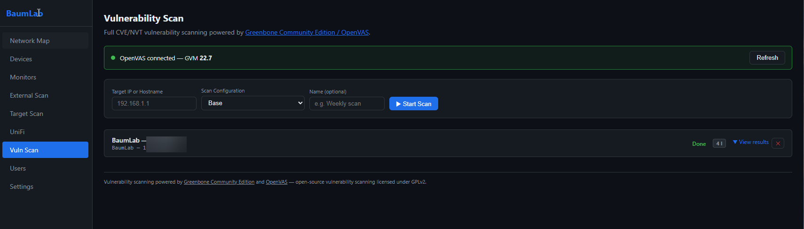

# BaumLab

A self-hosted home lab monitoring, mapping, and security dashboard. Discover everything on your network, watch service health in real time, scan for open ports and vulnerabilities, and pull live data from your UniFi controller — all in one dark-themed web UI.



---

## Features

### Network Discovery
- **nmap-based scanning** — ARP host discovery across one or more CIDR ranges
- **Automatic device classification** — heuristic typing by MAC vendor, open ports, and OS fingerprint (router, NAS, server, Raspberry Pi, Apple device, etc.)
- **Live scan log** — scrolling output streamed to the UI while a scan runs
- **Device management** — edit labels, device type, VLAN tag, and notes per device; delete stale entries

### Network Map
- **Interactive topology diagram** (ReactFlow) showing gateways → switches/APs → clients
- **VLAN colour coding** — up to 6 colours distinguish network segments at a glance
- **UniFi enrichment** — overlays UniFi client/device data (signal strength, model) onto discovered hosts

### Service Inventory
- **Track every self-hosted service** — host, platform (Docker/VM/LXC/bare metal), IP, port, protocol, VLAN, access URL, notes
- **Access flags** — behind reverse proxy, behind SSO (Authentik), internet-facing; highlights public services without SSO
- **Group by** category, host, VLAN, platform, or access type, with search
- **Device & monitor linking** — IP suggestions (and VLAN auto-fill) from discovered devices; link a monitor to show live up/down
- **Discovery** — suggests services from running Docker containers (via Portainer) and device port scans; review, edit and add in bulk
- **Linked pieces** — creating a service can also create its health monitor and a vault entry for its login
- **Lifecycle status** — active / planned / decommissioned (with date), so retired services stay in the history
- **Credentials pointer** — link each service to its Vaultwarden item (BaumLab never stores the secret)
- **Export to PDF** — printer-friendly inventory with check-off boxes for auditing what you actually have running
- **Git sync (Forgejo / Gitea)** — commits `README.md`, `services.yaml` and per-host pages to an infra repo; every add/change/decommission becomes a descriptive commit (edits within 30 s are batched)

### Service Monitors
- **Continuous health checks** — ICMP ping, raw TCP connect, HTTP/HTTPS status checks
- **Per-target intervals** — configure each monitor independently (seconds granularity)
- **Live results** — latency, status code, up/down history
- **Overall status roll-up** — Operational / Degraded / Outage / Unknown
- **Public status page** — unauthenticated read-only view embeddable in dashboards (e.g. BaumDash Status tab)

### Port Scanning
- **Quick scan** — common, top-100, or top-1000 port presets
- **Deep scan** — nmap NSE scripts extract SSL certificates, TLS cipher suites, HTTP server headers and page titles, SMB security negotiation details
- **Per-device on-demand** — trigger a port scan from the Devices page for any host

### External Scanning
- **Public IP detection** — fetch the server's external IP
- **Port probe** — socket-based scan of 20 common ports (FTP, SSH, HTTP, HTTPS, RDP, VNC, MySQL, etc.) against any external host
- **DNS lookup** — resolve any domain to all IPv4 and IPv6 addresses

### Vulnerability Scanning (OpenVAS)
- **Greenbone Community Edition** bundled as a Docker service — no separate install
- **Scan task management** — create, launch, monitor progress, view results, delete tasks
- **CVSS-rated findings** — colour-coded severity badges (Critical / High / Medium / Low / Log)
- **Scan configuration picker** — choose from all configs available in your OpenVAS instance
- Connects via GMP Unix socket or TLS/TCP

### UniFi Integration
- **Clients** — connected WiFi and LAN clients with IP, MAC, VLAN, signal strength (dBm), TX/RX bytes
- **Devices** — APs, switches, gateways with model, uptime, CPU, memory
- **Networks** — configured VLANs and network segments
- **Switch port stats** — per-port traffic on managed switches
- Supports both **classic UniFi Controller** and **UniFi Dream Machine / UDM Pro** (API key or username/password auth)

### Authentication & Users
- **JWT login** with configurable token expiry
- **TOTP two-factor authentication** — QR code setup, per-user enable/disable
- **Role-based access** — admin and standard user roles
- **User management** — create, edit, delete users (admin only); each user manages their own MFA
- Auto-creates an initial admin account on first startup

### Settings
- **UniFi** — URL, credentials, site, controller type, SSL verification; test connection button
- **Scan** — default CIDR ranges, auto-scan toggle and interval
- **OpenVAS** — socket path or host/port, credentials; test connection button
- **Git Sync** — Forgejo / Gitea repo URL, token, branch, folder, auto-sync toggle; test connection button
- **Repository Sources** — Git hosts listed on the Repositories page
- **Updates** — check GitHub for new releases and apply them through Portainer (see [Updates](#updates))

### Backups (merged from BaumLabBackup)
- **Container jobs**: archive Docker volumes and bind mounts, optional PostgreSQL / MySQL dump, optionally stop containers for a consistent copy (restarted before the upload), cron schedules and retention
- **Stack backups** for disaster recovery: a compose project's named volumes, its environment (encrypted) and the repo it deploys from
- **Destinations**: Backblaze B2, SMB / NAS, SFTP, local folder (via rclone; credentials stay encrypted and are only handed to rclone while it runs)
- **Restore**: pick an archive and restore volumes and/or the database. For stacks: restore volumes and view the saved `.env` to redeploy in Portainer
- **Coverage**: every service shows whether it is protected and whether the last backup is fresh. Manual records cover backups made elsewhere (Unraid, Proxmox, NAS snapshots)
- **Import** an existing BaumLabBackup database (destinations, jobs, stacks)

### Terminal
- **Browser SSH** to your machines with **multiple tabs** (xterm.js): colours, resizing, clickable links, reconnect without losing scrollback
- **Hosts** can be picked from discovered devices and linked to services. Passwords and private keys are stored in the **vault**, decrypted only while connecting, and every use is audited.
- **Host keys pinned on first connect**: if a host's key changes, BaumLab refuses to connect (before sending any credentials) until you confirm
- Admin-only, locked with the vault; session log of who connected where and when; idle sessions close after an hour
- Behind Nginx Proxy Manager, turn on **Websockets Support** for the BaumLab proxy host

### Launchpad
- **Links page built from the Services inventory**: tiles grouped by category with icons and live up/down dots, so it never drifts from what you actually run. Hidden or decommissioned services drop off automatically.
- **Bookmarks** for links that aren't services (router UI, cloud consoles, docs)
- **Icon library**: search [Dashboard Icons](https://github.com/homarr-labs/dashboard-icons) (about 2,000 home lab app icons, searchable by alias) or upload your own. Icons you pick are stored in BaumLab, so they work offline. **Auto-assign** matches icons to everything by name.
- **Import from Heimdall**: reads Heimdall's links and icons straight from its container, then attaches them to matching services, creates services or adds bookmarks (review before import)
- **Drag-and-drop layout**: reorder tiles, move them between groups, reorder groups
- **Home page** at `/home`: a full-screen start page. Signed in, you see every tile. Visitors who aren't signed in see only tiles you mark 🌐 public (off by default). Behind Authentik, the proxy must let `/home`, `/assets`, `/api/launchpad/public` and `/api/icons/file` through for that.
- **Export / import** the whole Launchpad (icons, layout and public flags included) as one JSON file
- Search with `/`; Enter opens the first match

### Dashboard
- **Home page** with tiles for monitors, services, backups, certificates, devices, Docker and BaumLab version, each linking to its section
- **Needs attention**: monitors down, failing or stale backups, expiring certificates, public services without SSO, crash-looping containers, available updates
- New devices this week and recent alerts

### Certificates
- **TLS expiry tracking** for every service with an `https://` URL or https protocol, plus hosts you add
- Issuer, covered names, expiry date, trusted vs self-signed; checked daily or on demand
- Alerts at 21 days, 7 days and on expiry

### Alerts
- **Channels**: ntfy, Discord, email (SMTP), generic JSON webhook (Gotify, Home Assistant, …), each with a minimum severity and a test button
- **Events**: monitor down / recovered (after N failed checks in a row), backup failed or finished with warnings, backup stale, new device (unknown MAC), BaumLab update available
- Fires on changes, not on every check; every alert is kept in a history with per-channel delivery results

### Repositories
- **One view across Git hosts** — GitHub, GitHub Enterprise, Gitea and Forgejo sources (Settings → Repository Sources, read-only token)
- Description, language, last activity and latest release per repo; group by source, owner or language; hide forks / archived
- Refreshed hourly and on demand

### Tools
- **Secret keys** — hex-32, base64url, JWT hex-48, database passwords (compose-safe), alphanumeric keys, UUIDs; generated in the browser
- **Vaultwarden admin token** — Argon2id PHC string (OWASP preset) plus the login password, with a docker-compose-escaped variant
- **htpasswd (bcrypt)**, **WireGuard keypairs**, **subnet calculator**, **base64 / JWT decoder**
- **Save to Vault** — store any generated key in the vault with its purpose

### Credential Vault
- **Encrypted password store** linked to services: reveal, copy, generate, encrypted notes
- **Admin-only with audit log**; locks itself if the deployment isn't safe for secrets (see [Credential Vault](#credential-vault))

---

## Stack

| Layer | Tech |
|-------|------|
| API | FastAPI + SQLModel (SQLite) |
| Scheduler | APScheduler |
| Discovery | python-nmap + mac-vendor-lookup |
| Monitoring | icmplib + httpx |
| Vuln scanning | Greenbone OpenVAS (GMP protocol) |
| Frontend | React 18 + Vite + ReactFlow + Zustand |
| Auth | JWT + pyotp (TOTP 2FA) |
| Deploy | Docker + Compose |

---

## Quick Start

```bash
git clone https://github.com/Bruiserbaum/BaumLab.git
cd BaumLab

# Set required environment variables
cp .env.example .env
# Edit .env — set SECRET_KEY, ADMIN_PASSWORD, and OPENVAS_ADMIN_PASSWORD

# Copy and edit config
cp config/config.yaml.example config/config.yaml
# Edit config.yaml — set your scan ranges and (optionally) UniFi credentials

docker compose up -d
```

| Service | URL |
|---------|-----|
| Dashboard | http://localhost:3100 |
| API docs | http://localhost:8100/docs |
| OpenVAS UI | http://localhost:9392 |

> **First run:** OpenVAS takes 15–60 minutes to sync its vulnerability feed before scans can run.

---

## Configuration

### Environment Variables (`.env`)

| Variable | Default | Description |
|----------|---------|-------------|
| `SECRET_KEY` | — | **Required.** JWT signing key — generate with `openssl rand -hex 32` |
| `ADMIN_USERNAME` | `admin` | Initial admin username |
| `ADMIN_PASSWORD` | — | **Required.** Initial admin password |
| `TOKEN_EXPIRE_HOURS` | `8` | JWT token lifetime |
| `API_PORT` | `8100` | API container port |
| `UI_PORT` | `3100` | Frontend container port |
| `OPENVAS_ADMIN_USERNAME` | `admin` | OpenVAS admin user |
| `OPENVAS_ADMIN_PASSWORD` | `changeme` | **Change this.** OpenVAS admin password |
| `OPENVAS_PORT` | `9392` | Greenbone Security Assistant port |
| `OIDC_ENABLED` | `false` | Set to `true` to enable Authentik SSO login |
| `OIDC_ISSUER` | — | Authentik provider URL — `https://auth.yourdomain.com/application/o/<app-slug>/` |
| `OIDC_CLIENT_ID` | — | OAuth2 client ID from Authentik |
| `OIDC_CLIENT_SECRET` | — | OAuth2 client secret from Authentik |
| `OIDC_REDIRECT_URI` | — | Full callback URL — `http://your-server:8100/api/auth/oidc/callback` |
| `OIDC_FRONTEND_URL` | *(empty)* | Only needed when API and frontend are on different ports with no shared proxy |
| `AUTHENTIK_HEADER_AUTH` | `false` | Log in from NPM forward-auth headers |
| `AUTHENTIK_PROXY_SECRET` | — | Shared secret NPM must send as `X-BaumLab-Proxy-Secret`; **required with header auth** |
| `VAULT_KEY` | *(SECRET_KEY)* | Credential vault encryption key — back it up |
| `TZ` | `UTC` | Time zone for backup schedules, e.g. `America/New_York` |

### `config/config.yaml`

```yaml
scan:
  default_ranges:
    - "192.168.1.0/24"
  auto_interval_minutes: 60

unifi:
  url: "https://192.168.1.1"   # Leave blank to disable
  username: "admin"
  password: "changeme"
  site: "default"
  verify_ssl: false
  controller_type: "udm"        # "classic" or "udm"

monitor:
  default_interval_seconds: 60
```

All UniFi and OpenVAS settings can also be changed at runtime from the Settings page without editing files.

---

## Authentik SSO (Optional)

BaumLab supports OIDC login via Authentik. When enabled, a **Login with Authentik** button appears on the login page alongside the standard username/password form. Both methods coexist — existing local accounts are unaffected.

### Setup

1. In Authentik, create an **OAuth2/OpenID Provider** and an **Application** for it.
2. Set the redirect URI to: `http://your-server:8100/api/auth/oidc/callback`
   (or `https://baumlab.yourdomain.com/api/auth/oidc/callback` if behind a reverse proxy)
3. Set the OIDC env vars in `.env` and uncomment them in `docker-compose.yml`.
4. Rebuild and restart: `docker compose up -d --build`

First-time SSO users get a local account created automatically. OIDC users cannot log in with a password — their account is linked to the Authentik subject ID.

### Forward-auth header login (NPM)

With `AUTHENTIK_HEADER_AUTH=true`, BaumLab logs users in from the `X-authentik-username` header that NPM adds after Authentik approves the request. BaumLab cannot tell that header apart from one a client sends itself to ports 3100/8100, so **also set `AUTHENTIK_PROXY_SECRET`** and have NPM send it. In the proxy host's Advanced config, add this inside the same `location` block that sets `X-authentik-username`:

```nginx
proxy_set_header X-BaumLab-Proxy-Secret "<value of AUTHENTIK_PROXY_SECRET>";
```

Header logins without the matching secret are rejected. The credential vault stays locked while header auth is on without a secret.

---

## Credential Vault

Admins can store passwords per service on the **Vault** page.

- Passwords and notes are encrypted (Fernet / AES) with a key derived from `VAULT_KEY`, or from `SECRET_KEY` if `VAULT_KEY` is unset. The key only exists in the container environment, so a copy of `data/` or `config/` alone reveals nothing.
- **Back up the key.** If it changes or is lost, stored passwords cannot be recovered.
- Admin-only. Each reveal, copy, create, update and delete is written to an audit log, and revealed passwords hide again after 30 s.
- Never included in Git sync or PDF exports.
- Locks itself when it isn't safe to use: when `SECRET_KEY` is still the default (login tokens could be forged), or when header auth is on without `AUTHENTIK_PROXY_SECRET`.

---

## Backups

The api container mounts `/var/run/docker.sock` so it can stop and start containers, dump databases and archive volumes. That gives BaumLab root-equivalent control of the Docker host, as the Portainer API key it can store already does, so keep it behind Authentik and set `AUTHENTIK_PROXY_SECRET`. Volumes are archived by short-lived `alpine` containers. `/tmp/baumlab-backup` is the scratch folder and must be mounted at the same path on the host and in the container (see `docker-compose.yml`).

**Moving from BaumLabBackup:**
1. Run `docker cp baumlabbackup:/data/baumlabbackup.db .`
2. In Backups → Import, upload that file along with BaumLabBackup's `SECRET_KEY`.
3. Stop BaumLabBackup, then enable the imported jobs. They are imported disabled so nothing runs twice.

Existing archives stay restorable.

---

## Updates

BaumLab checks the GitHub repo's `vX.Y.Z` tags every 6 hours and shows **↑ vX.Y.Z available** in the sidebar. Admins can apply the update from **Settings → Updates**:

1. Deploy BaumLab in Portainer as a **Git repository stack**. Set `BAUMLAB_DATA_PATH` and `BAUMLAB_CONFIG_PATH` to absolute host paths in the stack's environment variables. Stacks started with `docker compose` on the host show as "created outside of Portainer" and can't be redeployed this way.
2. Add that Portainer instance on the **Docker** page (URL + API key).
3. In Settings → Updates, pick the connection and the BaumLab stack, then click **Apply Update**.

BaumLab asks Portainer to redeploy the stack at the new tag. Portainer pulls it, rebuilds the images (`pull_policy: build`) and restarts the containers, and the page reloads once the new version answers. The stack's environment variables are sent back unchanged. The stack's Git reference is switched to the release tag (e.g. `refs/tags/v1.5.0`). OpenVAS's image is not re-pulled. Forks can point the check at their own repo.

---

## Network Scanning Notes

For ARP-based discovery and raw ICMP ping, the API container needs elevated network capabilities. These are already set in `docker-compose.yml`:

```yaml
cap_add:
  - NET_ADMIN
  - NET_RAW
```

For full ARP scanning on Linux hosts, switch the API to host networking:

```yaml
network_mode: host
```

Then restart: `docker compose up -d api`

> `network_mode: host` is Linux-only. On Windows/Mac, scanning is limited to what the bridge network can reach.

---

## API

Full interactive docs available at `http://localhost:8100/docs` when running.

| Endpoint group | Description |
|---------------|-------------|
| `POST /api/auth/login` | Authenticate (returns token or MFA challenge) |
| `GET /api/devices` | List all discovered devices |
| `POST /api/scan/network` | Start a background network discovery scan |
| `POST /api/scan/ports/{id}` | Deep port scan a specific device |
| `GET /api/monitors` | List service monitors |
| `GET /api/status/public` | Public monitor status (no auth) |
| `POST /api/advanced-scan/start` | Advanced NSE port scan |
| `GET /api/external-scan/ip` | Get server's public IP |
| `POST /api/external-scan/ports` | Probe external ports |
| `GET /api/unifi/clients` | UniFi connected clients |
| `GET /api/unifi/devices` | UniFi network devices |
| `GET /api/vuln-scan/tasks` | List OpenVAS scan tasks |
| `POST /api/vuln-scan/start` | Launch a vulnerability scan |
| `GET /api/settings` | Get current settings (admin) |
| `GET /api/users` | User management (admin) |

---

## BaumLab Suite
**[Download BaumLab Suite](https://github.com/Bruiserbaum/BaumLab/releases/latest)** — a single Windows installer that installs and keeps all BaumLab apps up to date.
BaumLab Suite checks GitHub for the latest release of each app, detects what you already have installed via the Windows registry, and silently installs or updates your selection — no wizard windows, no manual downloads.
### Apps included
| App | Description |
|-----|-------------|
| [BaumDash](https://github.com/Bruiserbaum/BaumDash) | Ultrawide desktop dashboard — audio mixer, media controls, Discord voice, system stats |
| [BaumLaunch](https://github.com/Bruiserbaum/BaumLaunch) | WinGet GUI package manager with system tray updater and curated app catalog |
| [BaumAdminTool](https://github.com/Bruiserbaum/BaumAdminTool) | Windows admin utility — system overview, process monitor, RoboCopy backup, event logs |
| [BaumSecure](https://github.com/Bruiserbaum/BaumSecure) | Homelab security analyzer — scans your external attack surface and flags misconfigurations |
| [BaumScriptCodex](https://github.com/Bruiserbaum/BaumScriptCodex) | Script library for IT admins — store, search, tag, and copy PowerShell/Bash/Batch scripts |
| [BaumKeyGenerator](https://github.com/Bruiserbaum/BaumKeyGenerator) | Secret key generator — hex, base64, JWT, database passwords, Vaultwarden Argon2 tokens |
### How it works
1. Launch BaumLab Suite — it queries the GitHub releases API for each app in parallel
2. Installed versions are detected from the Windows registry (Inno Setup uninstall entries)
3. Apps with available updates are highlighted in amber
4. Check the apps you want, then click **Install / Update Selected**
5. Each installer runs silently in the background — progress and status shown in real time
**Requirements:** Windows 10 21H1 or later, x64. No .NET runtime required (self-contained).
Source: [BaumLabSuite/](BaumLabSuite/)
---
## Related Projects
- [BaumLab Suite](https://github.com/Bruiserbaum/BaumLab/releases/latest) — One-click installer and updater for all BaumLab apps (this repo)
- [BaumDash](https://github.com/Bruiserbaum/BaumDash) — Desktop dashboard with audio mixer, Discord, media controls, and a Status tab that can embed the BaumLab public status page
- [BaumLaunch](https://github.com/Bruiserbaum/BaumLaunch) — WinGet-based GUI package manager for Windows
- [BaumAdminTool](https://github.com/Bruiserbaum/BaumAdminTool) — Portable dark-theme Windows admin utility
- [BaumDocker](https://github.com/Bruiserbaum/BaumDocker) — Home lab Docker stack collection
- [BaumSecure](https://github.com/Bruiserbaum/BaumSecure) — Windows home lab security analyzer
- [BaumScriptCodex](https://github.com/Bruiserbaum/BaumScriptCodex) — Script library for IT admins
- [BaumKeyGenerator](https://github.com/Bruiserbaum/BaumKeyGenerator) — Secret key and token generator---

## License and Project Status

This repository is a personal project shared publicly for learning, reference, portfolio, and experimentation purposes.

Development may include AI-assisted ideation, drafting, refactoring, or code generation. All code and content published here were reviewed, selected, and curated before release.

This project is licensed under the Apache License 2.0. See the LICENSE file for details.

Unless explicitly stated otherwise, this repository is provided as-is, without warranty, support obligation, or guarantee of suitability for production use.

Any third-party libraries, assets, icons, fonts, models, or dependencies used by this project remain subject to their own licenses and terms.